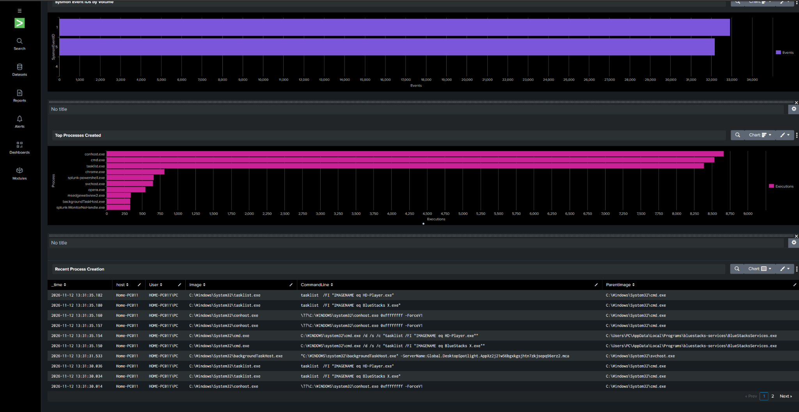
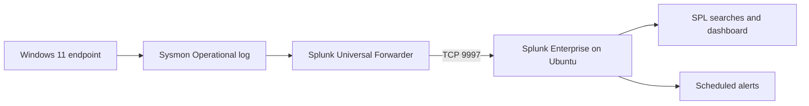
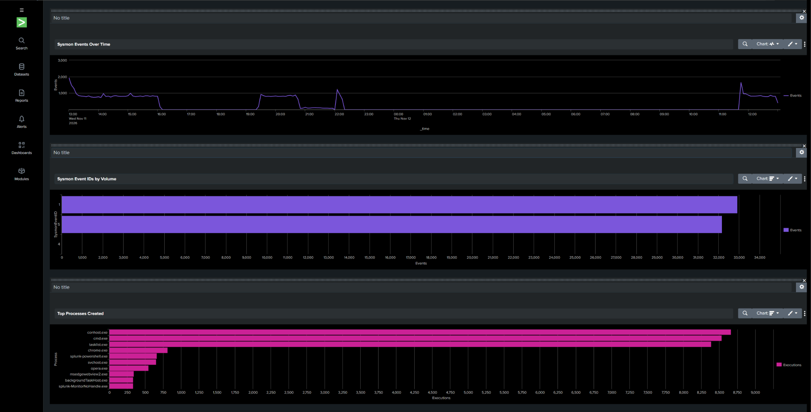
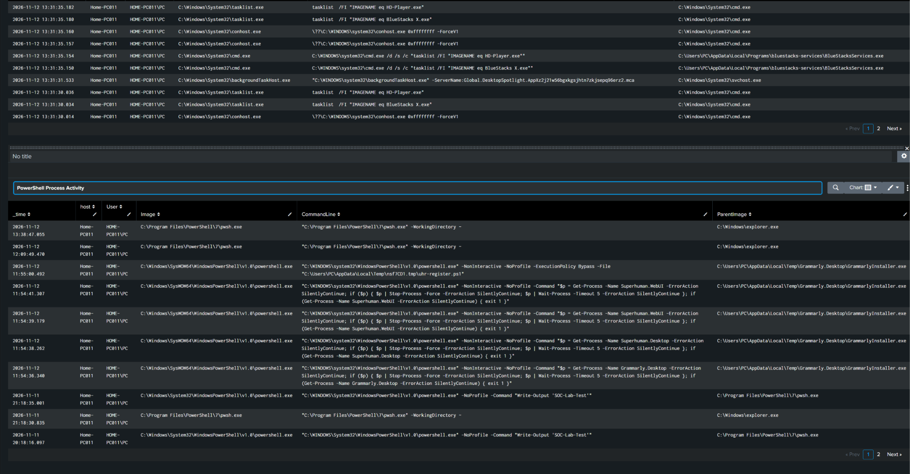
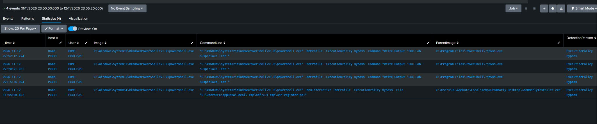
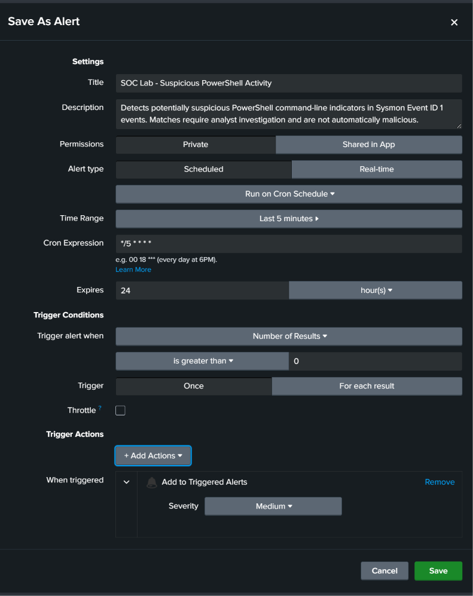
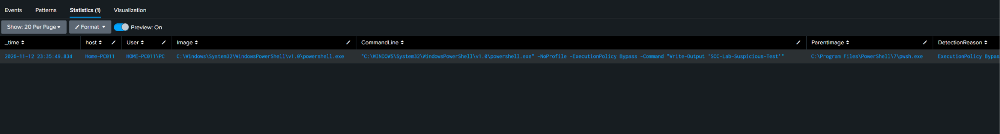

# Windows Endpoint Monitoring and PowerShell Detection with Splunk and Sysmon



## Project overview

This personal cybersecurity lab demonstrates Windows endpoint telemetry collection, SIEM troubleshooting, SPL analysis, dashboard development and scheduled detection engineering. Microsoft Sysmon records endpoint activity on a Windows 11 host. The Splunk Universal Forwarder sends the events to Splunk Enterprise on an Ubuntu virtual machine for searching, visualisation and alerting.

The project was completed as hands-on laboratory work and does not represent professional SOC employment.

## Objectives

- Collect detailed Windows process telemetry with Sysmon.
- Forward the Sysmon Operational log to Splunk Enterprise.
- Troubleshoot a missing-data and forwarding problem methodically.
- Extract useful fields from XML events with SPL.
- Build an analyst-friendly endpoint monitoring dashboard.
- Detect and investigate potentially suspicious PowerShell command lines.
- Validate the detection using a harmless controlled test.

## Lab architecture



| Component | Purpose |
|---|---|
| Windows 11 | Monitored endpoint |
| Sysmon64 | Process and security telemetry |
| Splunk Universal Forwarder | Reads and forwards Windows events |
| Ubuntu VM | Hosts Splunk Enterprise |
| Splunk Enterprise | Search, visualisation and alerting |
| PowerShell 7 | Controlled testing and investigation |

## Data collection

The dedicated forwarder input was stored at:

```text
C:\Program Files\SplunkUniversalForwarder\etc\apps\soc_lab_sysmon\local\inputs.conf
```

```ini
[WinEventLog://Microsoft-Windows-Sysmon/Operational]
disabled = 0
```

The effective configuration was checked with `btool`, the forwarder was restarted, and the receiving listener was verified on TCP port `9997`.

## SOC monitoring dashboard

The dashboard, **SOC Lab – Windows Endpoint Monitoring**, contains six panels:

| Panel | Purpose |
|---|---|
| Total Sysmon Events | Overall ingestion-health indicator |
| Sysmon Events Over Time | Five-minute activity trend |
| Sysmon Event IDs by Volume | Most common Sysmon event types |
| Top Processes Created | Most frequently executed processes |
| Recent Process Creation | Investigation table with user, command and parent process |
| PowerShell Process Activity | Focused visibility of PowerShell and PowerShell 7 activity |





## Suspicious PowerShell detection

The detection searches Sysmon Event ID 1 process-creation events for PowerShell indicators including:

- `ExecutionPolicy Bypass`
- `EncodedCommand`
- `FromBase64String`
- `DownloadString`
- `Invoke-WebRequest`
- `Invoke-Expression`

These indicators are investigation leads, not automatic proof of malicious activity. Command line, user, parent process, file path, signature and surrounding activity must be reviewed before classification.



The scheduled alert runs every five minutes, searches the previous five minutes and triggers once when the result count is greater than zero.



## Controlled validation

A harmless command was used to validate the complete pipeline:

```powershell
powershell.exe -NoProfile -ExecutionPolicy Bypass -Command "Write-Output 'SOC-Lab-Suspicious-Test'"
```

The command does not download content, decode a payload or change the permanent execution policy. Sysmon recorded the process, Splunk ingested it, the scheduled search matched the command line, and the alert produced a result with the reason `ExecutionPolicy Bypass`.



## Investigation findings

- Sysmon Event IDs 1 and 5 accounted for most observed activity, representing process creation and termination.
- High volumes of `conhost.exe`, `cmd.exe` and `tasklist.exe` were investigated rather than automatically treated as malicious.
- Repeated command lines were linked to the installed BlueStacks service checking for BlueStacks processes.
- The `BlueStacksServices.exe` file was in the expected application path and its Authenticode signature was valid and issued to Now.gg, Inc.
- Grammarly installer activity launched PowerShell with `-NonInteractive`, `-NoProfile` and `-ExecutionPolicy Bypass`. The parent process and temporary script path provided useful context; the event was treated as a review lead, not labelled malware.

## Troubleshooting summary

Normal Windows event channels were visible in Splunk while the Sysmon sourcetype returned no results. Both Windows services were running, so the investigation moved beyond service status. Forwarder logs showed connection timeouts, resets and a paused output queue. The receiving listener, effective input configuration and Sysmon channel were then verified. A dedicated Sysmon input was enabled, checked with `btool`, and the forwarder restarted. Sysmon events subsequently became searchable.

See [troubleshooting-notes.md](troubleshooting-notes.md) for the detailed investigation and [splunk-searches.md](splunk-searches.md) for the SPL used in the project.

## Skills demonstrated

- Windows and Linux administration
- Sysmon configuration and event interpretation
- Splunk Universal Forwarder troubleshooting
- TCP listener and data-path validation
- SPL searching, `rex`, `eval`, `stats`, `timechart` and `table`
- Dashboard and scheduled-alert development
- Process-tree and command-line analysis
- Evidence-based triage and false-positive awareness

## Limitations and next improvements

- The lab currently monitors one Windows endpoint.
- Search-time XML extraction is repeated across searches; production use would benefit from reusable field extractions or a supported add-on.
- The detection is keyword based and requires tuning or allowlisting to reduce legitimate installer activity.
- Future panels could cover network connections, DNS, file creation, registry modification and authentication activity.
- Alert enrichment could include hashes, signer details, asset criticality and user context.

## Interview summary

> I built and troubleshot a personal Windows endpoint SOC lab using Sysmon, the Splunk Universal Forwarder and Splunk Enterprise. I diagnosed missing Sysmon telemetry by checking service health, forwarder logs, the TCP 9997 listener and Splunk's effective input configuration. I then built a six-panel dashboard and a scheduled PowerShell detection, validated it with a harmless controlled command, and used process, command-line and parent-process context to distinguish investigation leads from confirmed malicious activity.

## Author

Micah K. Yego — MSc Computer Science with Cybersecurity

